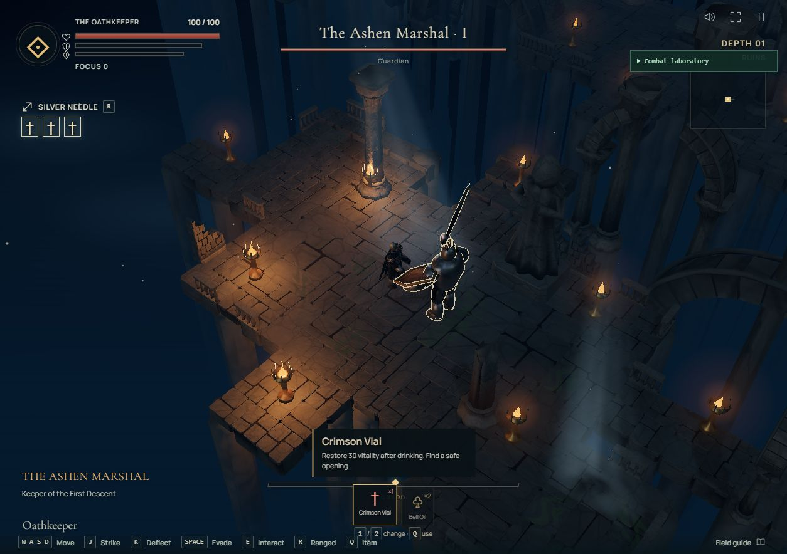
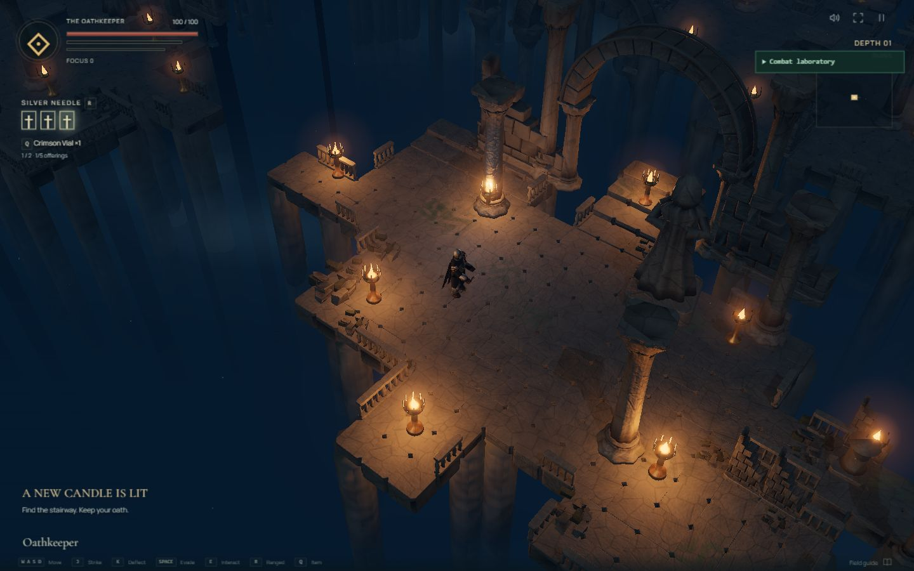
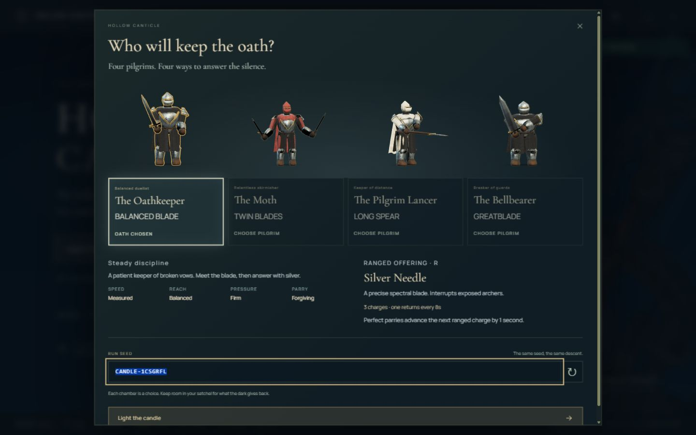

# Hollow Canticle — Trials of the Five Realms candidate

The `codex/v0.8.0-five-realms` branch adds a guardian at the end of every floor,
five distinct Blender realm guardians, tougher HP/guard balance, contextual enemy
counters and server-owned fire, resonance, spores, frost and molten hazards.
Fungal Depths gains ten new organic asset categories. Regional weather, varied
shafts from unseen openings and expanded Extreme presentation retain reduced
forms on Very Low through High.

**Implementation candidate, not accepted v0.8.** Package remains 0.7.0 until
acceptance. Full solo/co-op/Duel playtests, remaining captures and valid hardware
FPS are outstanding; approval limits and throttling are recorded explicitly.
See [QA](docs/QA-v0.8.md), [the eleven-request audit](docs/ORIGINAL-REQUEST-AUDIT-v0.8.md)
and [implementation report](docs/RELEASE-v0.8.md). No automatic merge is performed.



Use `?debug` for realm guardian/hazard practice, weather/wind/density/shafts/quality,
boss phase/HP/guard/attack controls, pause/step and local frame/telemetry exports.
Shared online practice requires a local server with `CANTICLE_LAB=1`; normal
multiplayer does not enable it. Client and authority require matching protocol 8.
The public play link below does not imply this candidate has been deployed.

## Preserved v0.7 Living Steel & Foundations

Living Steel adds layered character animation, the Ashen Shinobi, authoritative
nonlethal ripostes, shared visual/collision room geometry, five graphics profiles,
a visible offering quickbar, a detailed satchel, and replayable optional training.

The accepted base is `adb533e96da2565925a05ee3c58bc256733c4775` from
`codex/v0.7.0-living-steel`. The public play link below points to the multiplayer deployment.
See [v0.7 QA and implementation report](docs/QA-v0.7.md) for rules, measurements,
motion studies and acceptance limits.

Open `?debug` for the Combat Lab and collision overlay. Open
`?benchmark&view=animation` for neutral actor review, camera orbit, pose scrubbing
and 16-frame motion studies. The benchmark also includes a four-player/eight-enemy
rendering workload. Rebuild only the character pack with
`node tools/assets-build.mjs --characters-only`.

Shinobi has a separate black cloth and asymmetric lacquer-armour model, a shallow
travelling hat, short split scarf, curved katana and bronze springlock. Unlock him
for 16 Chronicle embers offline; all five Pilgrims are available online and in
training. Deflection or a springlock hit within 245 units opens a riposte: press
attack to dash, cut and return. The cut leaves at least 1 HP for a finisher.

**Online Co-op: 2–4 players · 1v1 Duels · Free friend-room codes**

The multiplayer branch adds server-authoritative friend rooms on Colyseus 0.18,
personal co-op loot, room-clear revival at exactly 20 HP, and normalized
first-to-three duels. Single-player still works independently.

The free multiplayer service may take a short moment to wake after inactivity.
Rooms live in memory and can disappear when the server restarts. There are no
accounts, paid services or multiplayer databases.

**[Play Hollow Canticle](https://guardianec.github.io/hollow-canticle-v05/)**

This is a public release candidate. The client runs on GitHub Pages and the
authority on [Render Free](https://hollow-canticle-online.onrender.com/healthz).
Hosted four-player connection/reconnection and two-player duel checks passed.
The [v0.6 QA record](docs/QA-v0.6.md) distinguishes those checks from the human
balance and sustained hosting measurements still needed. Both main branches
retain their preserved commits; Pages was published from the multiplayer branch.

Run `npm run dev:server` and `npm run dev` in two terminals. See
[multiplayer architecture and exact free deployment](docs/MULTIPLAYER.md),
[Render Blueprint](render.yaml) and [release status](docs/RELEASE-v0.6.md).

## Preserved v0.5 visual foundation

Animation, combat, Shinobi, world and UI references for current and future work
are saved in the [v0.7 reference library](docs/references/v07/README.md), alongside
the original Living Steel & Foundations release brief.

A procedural melee action roguelike about reading a blade, breaking a guard, and keeping an oath.

The v0.5 visual rebuild starts from accepted v0.4 commit
`8c83c8c4baa3476aaa9caa7b37bb9debfe13efd4`, with all five imported biome kits
and the complete cast. This preview has its own repository and deployment;
the original alpha repository and game remain preserved.

[Play the current candidate](https://guardianec.github.io/hollow-canticle-v05/) ·
[Play the preserved alpha](https://guardianec.github.io/hollow-canticle/) ·
[Deployment notes](docs/DEPLOYMENT-v0.5.md)

The preview has separate browser progress. Existing unlocks are copied once;
playing or resetting v0.5 leaves alpha progress untouched.



Open `?benchmark` for five-region lighting review, close duel, bridge/void test, material study
and procedural/Blender comparison. Camera orbit, pose sampling, screenshot export and
High/Medium/Low rendering controls are available there and in game settings. Open
`?visual=fallback` for the original presentation. Normal gameplay still generates its
rooms, routes, encounters and module choices from the seed, using imported biome packs.

There are 139 Blender-authored environment assets, 14 skinned characters, three LODs,
17 shared PBR families, geometry-baked occlusion, seeded decals, reactive Shrine water,
height fog and deep chasms. Each region has its own darker lighting palette. Technical
integration is complete; artistic and hardware acceptance limits remain documented in
the [visual review](docs/VISUAL_REVIEW-v0.5.md) and [QA report](docs/QA-v0.5.md).

The [polish checkpoint](docs/POLISH-v0.5.md) adds twelve weapon-specific executions,
connected whole-body attacks with articulated ankles, mixed flagstones, clearer HUD
icons and modern strike/deflection effects. Walk toward a cleared doorway to cross
automatically, or use E/the interaction button. Stand inside the pale seal and use
E/the descent button to reach the next depth.

### Rebuild assets

Blender 4.5 LTS and free npm tooling are the only content tools. Put `blender` on PATH,
or set `BLENDER` to its executable. Normal development uses committed GLBs and maps;
Blender is only needed to regenerate them.

```sh
npm run assets:build
npm run assets:validate
```

`tools/blender/` generates original geometry, UVs, semantic rigs, LODs and baked maps.
`tools/optimize-assets.mjs` compresses GLBs with meshoptimizer and generates
1024px/512px WebP maps from lossless bake sources
in the ignored `.cache/bakes/v05/` directory. Pass `npm run assets:build -- --rebake`
to refresh cached material sources. The full-resolution runtime art download is about
30 MiB before HTTP compression, with about 14 MiB for initial Ruins/cast art; other
packs load on demand. See the review for exact measurements and memory estimates.
References are preserved in `docs/references/v05/` and never used as game textures.

The v0.4 gameplay foundation is preserved.
Four Pilgrims bring different melee chains and rechargeable ranged offerings. Archers and
Acolytes add physical projectiles that can be deflected or perfectly reflected. Consumables,
timed effects and seeded room loot vary the journey before relic combinations develop.



## Play

Use Node 24 LTS:

```sh
npm install
npm run dev
```

Production checks and preview:

```sh
npm run lint
npm run test
npm run build
npm run preview
```

The game is a static site. Fonts, original textures, geometry, synthesized audio and saves
stay local. Keyboard and mouse are required; mobile layouts support the menus.

## Five Pilgrims

| Pilgrim        | Melee identity                                                                   | Ranged offering                                                | Capacity / sequential recharge | Inherent trait                                         |
| -------------- | -------------------------------------------------------------------------------- | -------------------------------------------------------------- | ------------------------------ | ------------------------------------------------------ |
| Oathkeeper     | Balanced cuts, advancing sweep, finishing point; forgiving guard                 | Silver Needle: fast, precise posture tool                      | 3 / 8 seconds per charge       | Perfect parries advance recharge by 1 second           |
| Moth           | Alternating hands, cross cut, step-through sweep; quick, close pressure          | Moth Knives: one quick knife per press                         | 5 / 5 seconds                  | Fourth-chain hits advance recharge by 0.8 seconds      |
| Pilgrim Lancer | Long, short and advancing thrusts, retreating sweep; spacing and counters        | Pilgrim’s Javelin: committed throw, pierces one additional foe | 2 / 11 seconds                 | Reflections deal 20% more posture pressure             |
| Bellbearer     | Full-body cuts, reverse sweep, overhead and shouldered thrust; crushing pressure | Last Toll: narrow travelling ground resonance                  | 2 / 12.5 seconds               | Guard breaks advance recharge by 2 seconds             |
| Ashen Shinobi  | Compact katana cuts; defensive guard pressure and nonlethal dash/return riposte  | Cinder Springlock: low damage, close-hit riposte setup         | 3 / 9 seconds                  | Normal/perfect deflections deal 20%/40% extra pressure |

Each has a four-step chain, a dedicated counter, a heavy input, a dodge follow-up and an
advancing opener. Waiting resets the chain. Attack buffering and recovery cancels preserve
parry/dodge response; simulation startup and recovery also drive animation timing.

The Oathkeeper starts unlocked. Chronicle unlock prices are 4 / 8 / 12 / 16 embers for the
Moth / Lancer / Bellbearer / Shinobi. All five models can be previewed. Existing weapon unlocks and
previously used weapons migrate to their corresponding Pilgrims.

## Focus and camera

The selected Pilgrim is outlined in the menu. **In gameplay the focused enemy receives the
outline**, following the requested control correction. The player retains the dungeon’s rim
lighting. A stronger focus-outline accessibility setting is available.

In cinematic combat, the cursor disappears and the player faces the focused opponent.
Move the mouse toward another opponent to switch focus; a motion threshold and short
cooldown prevent jitter. Tab / Shift+Tab also cycle focus. Clicking the combat canvas requests
relative mouse capture when supported; cursor hiding and gesture selection also work without
capture. Leaving close framing restores the cursor and free aiming. Pause restores menu input.

The enemy title, posture bar, melee/ranged targeting, camera and outline use the same focus.
A defeated target falls back to a living opponent. Incoming projectiles widen framing and
receive edge warnings when outside the view. Primary enemies hold duel spacing; secondary
melee enemies use a wider approach. Architecture retains the accepted foreground cutout.


## Ranged pressure and reflection

Ashen Archers support ruins, frozen and foundry encounters. Bell Acolytes support shrine and
fungal encounters. Eligible compositions roll ranged support at 27% on depths 2–3 and 38%
thereafter, subject to encounter budget. Depth 1 remains melee-only outside training/lab.
At most one support shooter is generated per normal composition, always with a melee front.

Archers vary normal, delayed and quick arrows. Acolytes vary slow, delayed and charged orbs.
They reposition for line of sight, retreat under pressure, and use a weak close strike when
cornered. Deeper shots use bounded prediction before release. Released arrows never home.
The Saint gains an orb attack in each phase. All old archetypes gain additional sequences.

Arrows, orbs, needles, knives, javelins and waves share a swept 2D collision simulation.
Room boundaries and major obstacles stop projectiles. Unreflected enemy shots ignore allies.
Normal parries dissipate shots and reward Focus/guard recovery. Perfect parries return them
toward their shooter, or a remaining hostile, at 1.3× speed with 1.6× HP damage and 62 posture
pressure. Reflected shots cannot hit the player. Dodge and finisher protection also apply.

Arrow defense uses a metallic fan and ping; magic uses pale green motes and a deeper resonance.
Effects originate at actual projectile contact. Ranged abilities cost charges at commitment,
release after their cast startup, and regenerate one charge at a time during simulation time.
Rooms do not refill them. Low HP damage, posture recovery at distance, and melee finishers
keep ranged tools tactical.


## Offerings and temporary effects

Carry five consumables total, at most two of a kind, with one selected offering and reserves.
Use times are 0.35–0.6 seconds. Damage interrupts use and the committed item is lost. Equal
buffs refresh duration instead of stacking; different effects coexist. Duration counts down
only while simulation advances and carries across rooms/floors, then clears on death/restart.

| Offering       | Effect                                               |
| -------------- | ---------------------------------------------------- |
| Crimson Vial   | Restore up to 30 HP after a 0.6-second drink         |
| Quiet Water    | Restore up to 25 HP over 8 seconds                   |
| Iron Incense   | 35% less incoming posture damage for 15 seconds      |
| Bell Oil       | 20% more posture pressure for 12 seconds             |
| Moth Draught   | 15% faster melee for 12 seconds                      |
| Pilgrim Salt   | 30% stronger counter posture pressure for 14 seconds |
| Ash Cordial    | 60% faster recharge for 16 seconds                   |
| Glass Tonic    | +35% damage and +20% incoming damage for 12 seconds  |
| Silver Powder  | Restore one ranged charge; rare                      |
| Warding Thread | Absorb one hit within 20 seconds; one ward maximum   |

Physical pickups use vial, incense, pouch and charm forms with ground halos. Approach and
interact to collect; full satchels leave the pickup in place. A new run starts with one vial.

## Less predictable relics

Ordinary combat starts with a **24% relic-offering chance**, replacing the guaranteed relic.
Misses add 2.5 percentage points, capped at +15, until the next relic roll. Elite / treasure /
secret base chances are 72% / 90% / 95%. Bosses guarantee a strong offering. Shrines grant a
30% relic / 70% temporary blessing interaction.

After an ordinary non-relic roll, relative weights are 25 empty / 20 embers / 20 consumable /
6 healing / 5 blessing. Empty outcomes simply reopen the room. Relic choices vary from one
to three; bosses/secrets offer three when enough remain, and boss choices exclude Faded relics.

There are 22 relics, including Returning Hymn, Hunter’s Prayer, Still Quiver and Glass Arrow.
Each run has nine seeded non-Sacred relics and two Sacred possibilities. Faded / Rare / Sacred
choice weights are 6 / 3 / 0.5, with stronger Sacred weight in boss/secret rooms. Exhausted
pools yield Silver Powder instead of repeat relics or free healing.

Audits over 200 six-floor main routes with one reward branch averaged 26.63% ordinary relic
rolls and 1.84 / 1.90 / 2.12 / 1.81 / 1.67 / 1.03 acquired relics per successive floor.
Full-clear routes exhaust the finite run pool sooner; unexplored relic families remain for
other seeds. See the QA report for exact sampling assumptions and healing supply.

## Controls

| Input                           | Action                                 |
| ------------------------------- | -------------------------------------- |
| WASD / arrows                   | Move relative to the camera            |
| J / left mouse                  | Chain strike; counter after a parry    |
| K / right mouse                 | Parry steel, arrows and orbs           |
| Space                           | Dodge                                  |
| L / Shift+left mouse            | Heavy strike                           |
| R / middle mouse                | Ranged offering                        |
| Mouse movement in close combat  | Switch focused opponent; cursor hidden |
| Tab / Shift+Tab in close combat | Cycle focused opponent                 |
| E                               | Interact / execute a broken opponent   |
| Q                               | Use selected consumable                |
| 1 / 2                           | Cycle the satchel                      |
| F                               | Release Resonance at 100 Focus         |
| Esc                             | Pause; also leaves mouse capture       |

## Existing world and local progression

The accepted procedural dungeon, ten architectural grammars, five biomes, 14–19-area floors,
loops, secrets, elites, two-phase Saint, articulated actors, sampled clips, biome effects,
and execution camera remain. Combat/navigation stay 2D-authoritative; elevation is visual.

Save schema v2 retains the existing storage key and migrates v1 settings, discoveries,
progress and unlocks. Active runs, inventory and buffs are not saved between browser sessions.
The ten most recent normal-run summaries stay in `hollow-canticle:local-runs:v1`, including
charges, hits, reflections, items, actual healing, buff uptime and relics per floor. Training
and laboratory runs do not write progression or history. Nothing is uploaded.

`?debug` enables the Combat Laboratory: encounter/character/biome selection, frame stepping,
projectile speed/type, charge/recharge controls, item give/drop/use, buff activation, forced
loot categories, 10,000-roll audit, collision/path display and local run statistics.

## Verification and limits

See [v0.5 QA](docs/QA-v0.5.md), [architecture](docs/ARCHITECTURE.md),
[screenshot review](docs/VISUAL_REVIEW-v0.5.md), and [roadmap](ROADMAP.md).

This is a review candidate. Automated regressions, production input/visual checks and three
short ordinary-run attempts were performed. Several complete multi-floor human playthroughs,
experienced-player balance sign-off, sustained GPU profiling and broader browser testing
remain outstanding. No minimum FPS or full release-acceptance claim is made. There are no
accounts, remote analytics, premium currency, touch/controller gameplay, active-run
resume, terrain IK or physics-driven projectiles.

Code and original assets: MIT. Third-party attributions are in [CREDITS.md](CREDITS.md).
