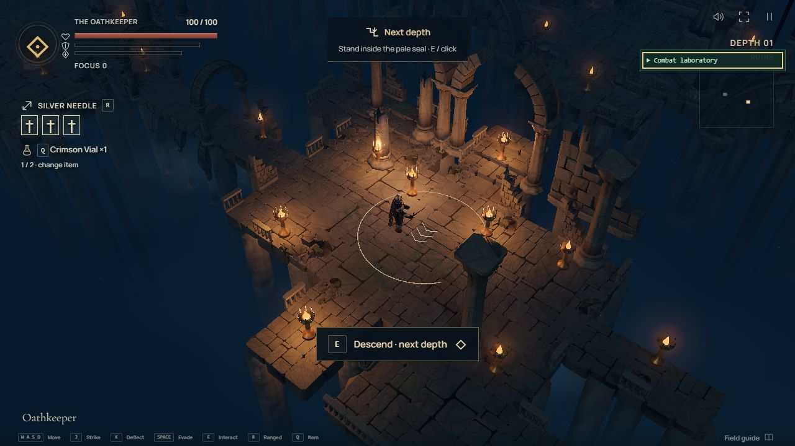
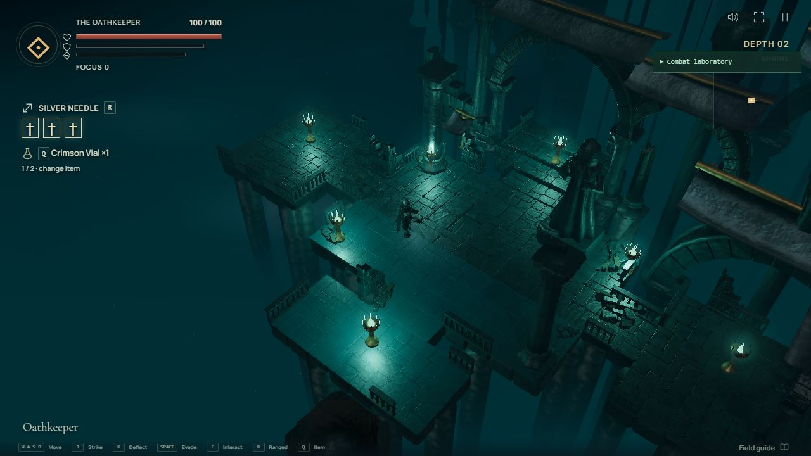
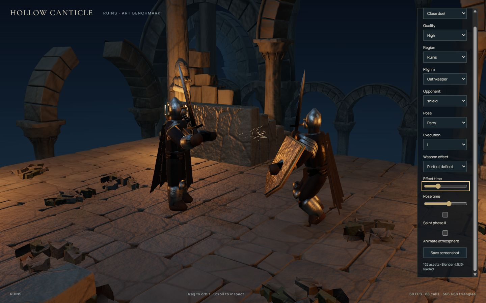
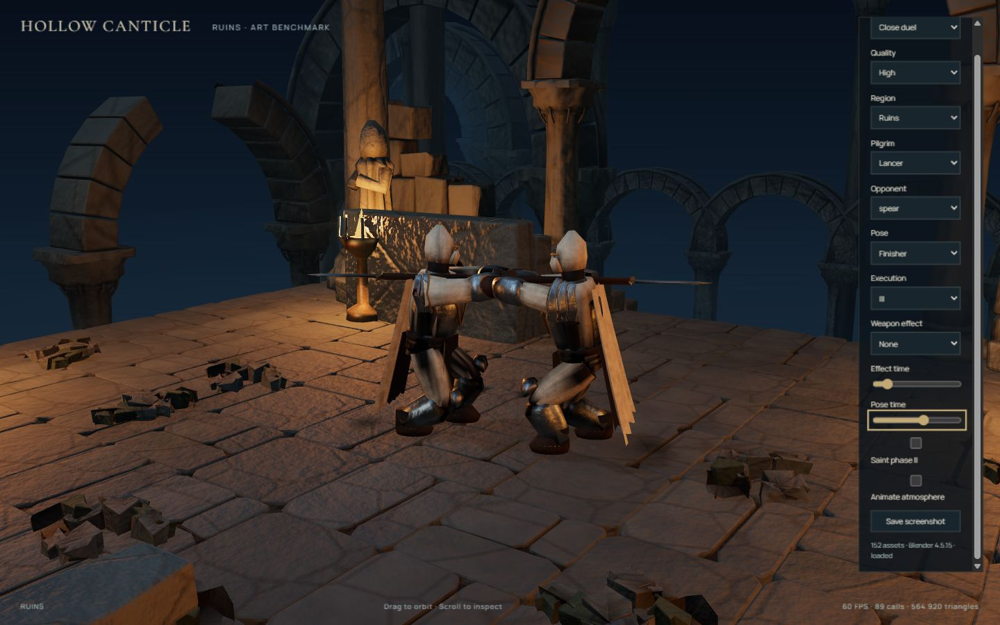

# v0.5.0 polish checkpoint — 2026-10-24

This checkpoint implements the complete requested polish list, including the later
enemy-leg correction. It is local on `codex/v0.5.0-blender-visual-overhaul`.

| Request                                         | Result                                                                                                                                                                                                                                                            |
| ----------------------------------------------- | ----------------------------------------------------------------------------------------------------------------------------------------------------------------------------------------------------------------------------------------------------------------- |
| Excessive glow on High                          | Lower bloom strength/radius, higher highlight threshold, toned torch cores and smaller halos. Region light colors remain distinct.                                                                                                                                |
| Over-reflective level 2                         | Re-baked wet stone at 0.56 roughness; Shrine water uses 0.42 roughness, zero metalness, lower opacity and restrained environment intensity.                                                                                                                       |
| Different executions for every pilgrim          | Three forms per weapon, twelve total. Seeded cosmetic rotation avoids consuming gameplay randomness; all forms retain the existing 0.7 s duration and 58% contact point.                                                                                          |
| More detailed, less repetitive procedural rooms | Six Blender flagstone layouts, irregular seeded 1×1/2×1/1×2/2×2 patches, per-stone tint, column/backdrop variants and small rubble clusters. Exact walkable coverage and elevations remain intact.                                                                |
| Clear next-level entrances                      | A pale standing seal matches the interaction radius, three downward chevrons, paired braziers, a “Next depth” hint and an explicit descent button.                                                                                                                |
| Automatic corridor passage                      | Walking toward a cleared doorway crosses automatically; standing still or moving away does not. Nearby E/click remains available. Combat, pending rewards, training and active actions prevent automatic crossing.                                                |
| Old-art flash during loading                    | Canvas stays covered until the cast and biome pack settle. Simulation waits during loading. Missing packs still resolve to the deliberate fallback.                                                                                                               |
| Clearer UI                                      | Larger/bolder labels and keys, visible resource/ranged/item icons, fewer secondary labels and clickable interaction prompts. Narrow-screen spacing separates the map, utilities and keyboard notice.                                                              |
| Modern strike/deflect effects                   | Tapered silver blade ribbons, thrust/overhead/sweep variants, dual trails for twins, directional ballistic sparks and a small contact glint. Arrow/orb deflections share this renderer. Legacy contact particles are suppressed without changing RNG consumption. |
| Legs detach during attacks                      | Motion goes through the shared skeletal root rather than the torso alone. Weighted stances, planted shins and two new ankle bones keep the body connected and soles level. All thirteen rigs and all LODs are rebuilt.                                            |

## Verification

- 102 tests in eight files pass, including floor coverage/height/determinism,
  automatic passage and manual fallback, twelve distinct execution contacts,
  loading/failure readiness and finite effects with reduced motion/flashes disabled.
- Rig regression checks exercise all thirteen imported characters at every LOD.
  Torso and thighs translate together; six semantic attack contacts retain level
  soles at the walking plane. Existing support-hand, combat, boss, projectile,
  item, loot, generation and save tests also pass.
- Lint, TypeScript, production build and asset validation pass. The asset library
  contains 152 assets, 15 PBR families and 505,800 unique LOD0 triangles.
- Browser inspection exercised the generated descent seal and clickable descent
  into the Shrine, revised regional lighting, mixed floor surfaces, HUD/selection
  layouts, execution variants and effects. No console errors appeared in the
  inspected game and benchmark sessions.
- Desktop, tablet and narrow previews were inspected. The narrow check found an
  overlap between the map and utility buttons and between the keyboard notice
  and weapon label; final CSS separates them.

The browser connection became unavailable during the final review. Bellbearer’s
three final contact poses and the last narrow-screen spacing adjustment have
automated/source verification but were not re-captured interactively. Full runs,
long GPU soaks and a broad hardware matrix remain outside this checkpoint.
Foot planting uses the local walking plane; it is not per-foot terrain IK.

## Review captures

These are browser captures, not generated concept art. Some motion/UI studies
precede the final ankle or spacing adjustment; the grounded-leg image shows the
final rebuilt ankle rig.

The benchmark adds execution I/II/III, weapon-effect selection and independent
effect-time scrubbing for continued local review. Normal play remains procedural.
