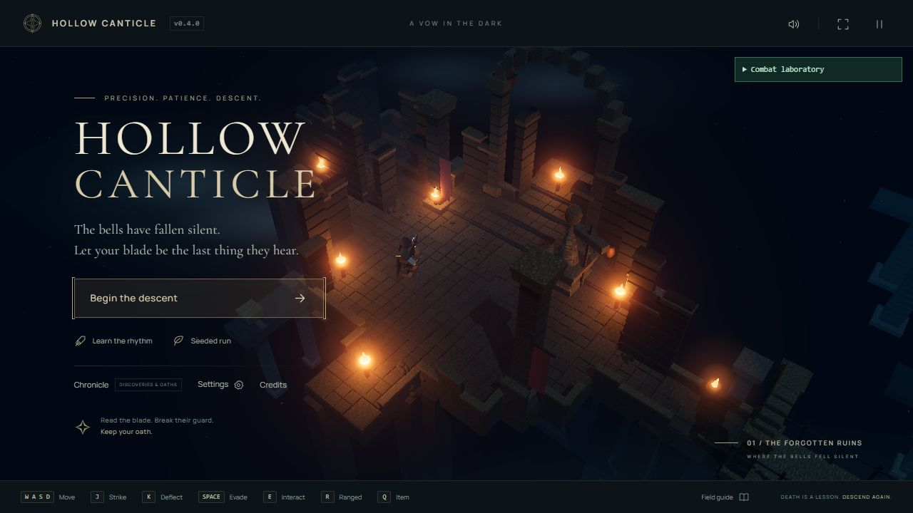
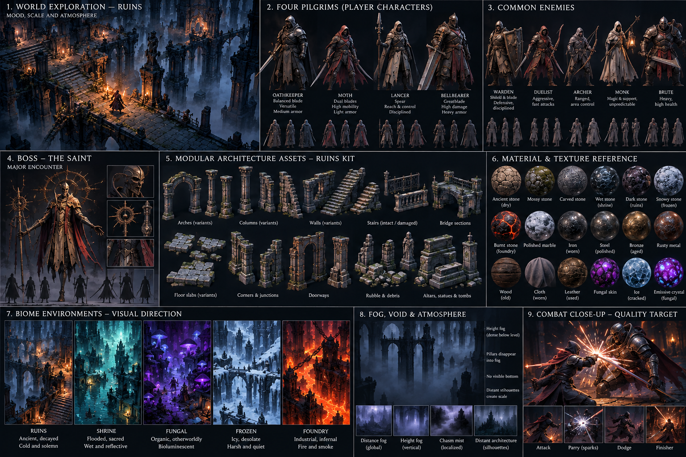
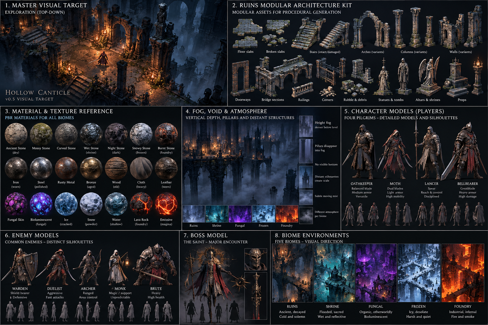
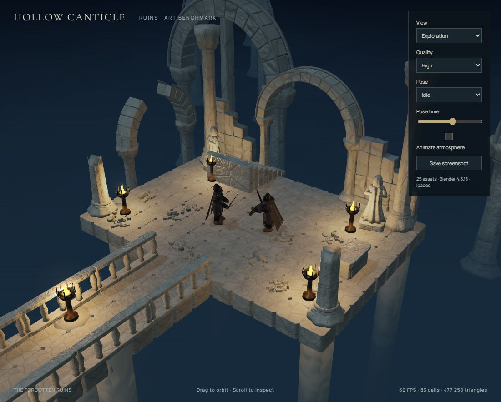
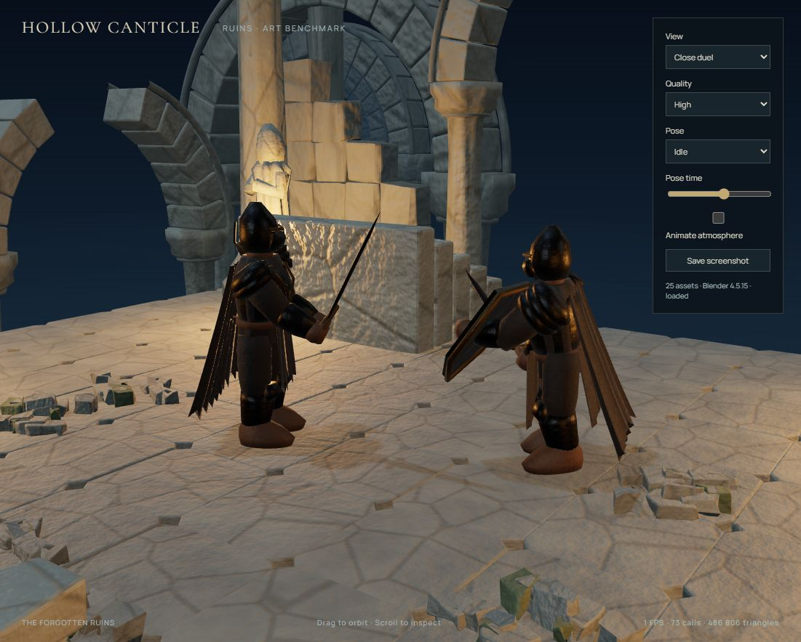

# v0.5 Ruins benchmark review — 2026-10-23

**Status: benchmark candidate; full v0.5 is unfinished. The Ruins art gate is not passed.**
The implementation makes the Blender workflow concrete and integrates its output,
but does not claim the visual fidelity of the supplied reference sheets. Do not scale
this asset recipe into four more biomes until the deficiencies below are resolved.

## Baseline, branch and tools

- Starting accepted v0.4: `8c83c8c4baa3476aaa9caa7b37bb9debfe13efd4`.
- Review branch: `codex/v0.5.0-blender-visual-overhaul`; main remains unchanged.
- Blender 4.5.15 LTS, build `5afeabba6097`, official portable Windows distribution.
- The local Steam Blender directory contained no executable. A portable copy was
  downloaded into ignored `.cache/tools/`; set `BLENDER` or use PATH on other machines.
- Scripts: `common.py` (mesh operations, UVs, AO), `materials.py` (procedural sources
  and Cycles bakes), `ruins.py` (architecture), `characters.py` (rigged cast benchmarks),
  `build.py` (LOD generation, export, manifest), plus npm build/optimize/validate scripts.
- No gameplay simulation, encounter, collision, item, projectile or save logic changed.

## Reference and screenshots

### Actual v0.4 baseline

Captured before code changes. This menu view is not the same camera as the art scene.
The benchmark comparison view additionally uses the original procedural Actor code;
its primitive arch is a representative comparison, not a replay of the baseline room.

### Supplied visual targets

### Current benchmark

## What exists

23 environment assets: three floor variants, broken floor, two columns, broken column,
arch, broken arch, large doorway, wall, broken wall, stairs, damaged stairs, railing,
bridge, rubble, statue, altar, tomb, pedestal, brazier and deep support. Each has three
Blender-decimated LODs. The complete unique LOD0 library has 64,398 triangles, including
the two character models. Instances reuse shared geometry and materials.

Oathkeeper and Warden have layered lofted armor, folded continuous cloth, a shaped
helmet, boots and an authored diamond-section sword. Warden adds a kite shield. Both
use the same 15-bone semantic structure with weighted cloak bones. Existing simulation
poses are converted through bone rest frames; attack timing remains authoritative.
Imported focused targets retain a skinned silhouette outline. Faces and fingers are
intentionally abstract. These are first benchmark models, not finished hero characters.

Seven material families: ancient stone, carved stone, moss stone, worn iron, aged
bronze, heavy cloth and leather. Blender nodes produce macro noise, stone fissures,
micro relief and roughness variation. Cycles bakes separate color, tangent normal,
roughness and AO maps. Geometry self-occlusion is also baked into vertex colors, since
flat material swatch AO cannot represent a column capital or armor overlap.
Base colors are sRGB; normal/scalar maps are data textures. Metalness is a uniform
per material family. Shared maps are 1024px, with 512px alternatives. Runtime WebP
encoding uses quality 85 color, 98 normal and 94 scalar maps; lossless PNG sources
remain rebuildable in the local cache. Inspect normal response after changing codecs.

The central AssetManager loads two packs, caches templates and textures, clones rigs,
instances multi-material modules and owns GPU resources. Room art seeds select the
floor variants and prop arrangements. Non-Ruins biome packs are deliberately absent;
their existing procedural builders remain active. `?visual=fallback` skips GLB loading.

## Atmosphere and void

Distance fog remains `FogExp2`. Shader hooks add world-space height extinction:
`1 - exp(-max(0, walkingHeight - worldY)^2 * 0.024)`. It is about 91% at 10 m below
the walking surface, 99.5% at 15 m and effectively opaque well before the support ends.
Supports extend 65 m down. There is no ground plane. Three broad noise mist sheets
add low-frequency chasm variation; the background grades from dark sky to the fog color.
Materials use the correct output color space so the deep architecture merges with fog.
Biome-specific colors apply to the existing four fallback environments too.

Torch pools are warm against cold ambient light. A neutral environment approximation
supplies metal response. Background silhouettes provide scale. Full volumetric
raymarching, SSAO and physical cloth simulation are not implemented.

## LOD, download and memory

- All assets export LOD0/1/2. Ruins rooms use instanced material groups under per-room
  LODs at 32/65 m; the fixed benchmark uses 34/65 m on High and earlier switches on
  Medium/Low. Characters use LOD0 for close combat and LOD1 for exploration.
- High/Medium/Low exist in the art benchmark. Normal gameplay retains the existing
  two-state quality setting, which also switches texture resolution.
- Runtime art at 1024px: **13,275,038 bytes (12.66 MiB)** for both GLBs plus requested
  full-resolution maps. This is lazy-loaded in addition to application code/fonts.
- Generated directory including both texture sizes and manifest: **14,630,993 bytes
  (13.95 MiB)**. References and screenshots live outside `public/` and do not ship.
- Complete production static directory: **21,350,773 bytes (20.36 MiB)**, including
  alternate texture sizes, application bundles, existing fallback assets and all font
  formats. This is the static payload, not a measured HTTP first-load transfer.
- Decoded 28 RGBA8 1024px maps with mipmaps would occupy about **149 MiB**; 512px maps
  about **37 MiB**. These are calculated texture budgets, not a GPU memory measurement.
  Superseded quality textures are disposed after a successful replacement.
- The active browser previously reported around 60 FPS for the benchmark, about 84
  main-view calls and 477k triangles. Background browser tabs throttle to about 1 FPS;
  those readings are not renderer throughput. Broad hardware performance is unproven.

## Gate assessment and next art pass

| Area         | Assessment                                                                                                                                                           |
| ------------ | -------------------------------------------------------------------------------------------------------------------------------------------------------------------- |
| Architecture | Curved arches, profiled columns and eroded footprints work. Ashlar walls and platform silhouettes are still too repetitive and clean.                                |
| Characters   | Continuous authored surfaces and animation work. Armor needs stronger design, natural anatomical proportions, better shoulder transitions and less rigid cape folds. |
| Materials    | Separate roughness/normal/color responses work. Stone still needs authored macro wear, localized moss and less uniform procedural fissures.                          |
| Void         | Deep supports fade without an exposed bottom in the fixed acceptance camera. Inspect extreme orbit angles before wider acceptance.                                   |
| Lighting     | Warm local pools and cold depth are present. Composition needs richer occlusion, more selective brightness and better character separation.                          |
| Scale        | Large silhouettes exist, but the fixed scene still reads as a small modular platform against a broad empty backdrop.                                                 |

Still procedural: Moth, Lancer, Bellbearer, other enemies, the Saint, all non-Ruins biome
architecture, character selection gallery, gameplay effects and several minor props.
No five-biome screenshot set, boss replacement, shader water, decals or biome-specific
material expansion is claimed. These remain v0.5 work after the Ruins gate, not finished
features deferred merely for a v0.5.1 label.

For v0.5.1 planning only after completing the v0.5 gate and cast/biome work: improve
texture atlasing, character hand/grip IK, hero normal bakes, background silhouette kits
and GPU memory instrumentation. Keep collision and navigation separate from all of it.
